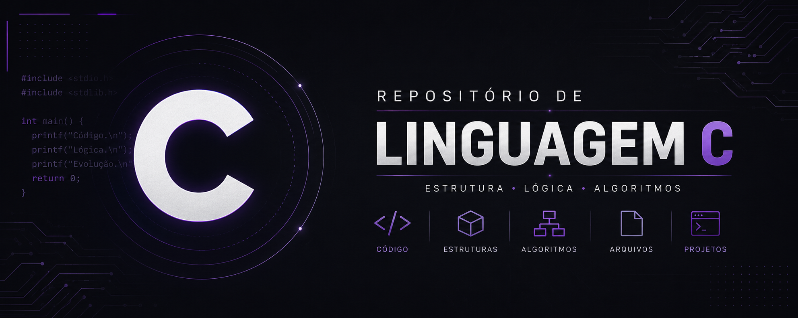

  

<h1 align="center">Repositório de Linguagem C</h1>

  <em>Estrutura • Lógica • Algoritmos</em>

  

Código:
Estudos e exercícios práticos em C, focados em fixar sintaxe, lógica de programação e boas práticas.

Estruturas:
Testes com structs, enums, arrays de tamanho fixo, ponteiros e manipulação de arquivos (texto e binário).

Algoritmos:
Implementações de lógica própria para CRUD (gravar, exibir, atualizar, excluir), validação de dados e hashing (ex: djb2 para senhas).

Arquivos:
Programas organizados por tema/teste dentro deste repositório.

Projetos:
- **Gerenciador de Chaves** — Sistema de senhas com CRUD completo (gravar, exibir, atualizar, excluir), dados salvos em arquivo binário via `fread`/`fwrite`, senha mestra protegida por hash (djb2) em vez de texto puro;

- **Projeto JSON (C + JS)** — Geração de dados em C (struct de pessoas) escritos manualmente em formato `.json`, depois lidos e interpretados por um script em Node.js;

  📧 joaovitorperes06@gmail.com &nbsp;•&nbsp; 💻 <a href="https://github.com/Peressjj">github.com/Peressjj</a>

